<!-- ============================================================ -->
<!--  Lucifer 的 GitHub 主页 · 终端风                                -->
<!--  放进名为 luciferoho 的公开仓库根目录即可生效                     -->
<!--  自绘素材在 assets/（终端窗口头图 / 分隔线 / 页脚），无第三方依赖  -->
<!-- ============================================================ -->

  

  
  

  
  
  
  
  

  
  

  

  <picture>
    <source media="(prefers-color-scheme: dark)" srcset="https://raw.githubusercontent.com/luciferoho/luciferoho/output/github-contribution-grid-snake-dark.svg" />
    
  </picture>

